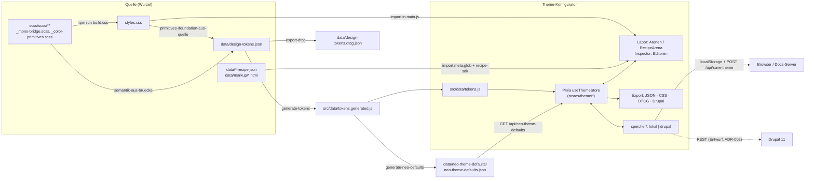

# NEO Theme-Konfigurator

Vue-App zum Anpassen des NEO-Standard-Themes an das Corporate Design eines
Kunden: Markenfarben, semantische Rollen (hell/dunkel), Foundation
(Abstände, Radien, Schatten, Typografie …), Komponenten-Tokens, Schriften,
Icons. Die Vorschau zeigt echte Komponenten des NEO Design Systems.

**Zielbild:** Die App wird Teil der Config Tools der **neo Workplace
Plattform (Drupal 11)**; gespeichert wird in der Drupal-Instanz des Kunden
als Config Entity (nur Abweichungen vom NEO-Standard, ohne Revisionen), mit
Rechten und Kontrast-Prüfung vor dem Veröffentlichen
([ADR-002](../../docs/adr/ADR-002-speichern-in-drupal.md), angenommen 01.10.2026). Heute läuft sie
lokal mit dem Docs-Server und speichert im Browser.

| | |
| --- | --- |
| App-Version | `package.json` → `1.2.30` (19.10.2026; Vertrag 1.1.1, Drupal-Modul `neo_theme_konfigurator` in DRUPAL11) |
| Stack | Vue 3.5, Pinia 3, Vite 7, Vitest 4, Playwright 1.56 |
| Node | 24 (wie CI, seit 20.10.2026; Docker-Bildvergleiche mit eigenem Node im Playwright-Abbild) |
| Architektur-Entscheidungen | [ADR-001 Token-Quelle](../../docs/adr/ADR-001-eine-quelle-vier-ausgaben.md) · [ADR-002 Speichern](../../docs/adr/ADR-002-speichern-in-drupal.md) · [ADR-003 Store](../../docs/adr/ADR-003-store-pinia-setup-stores.md) · [ADR-004 Server/Auslieferung](../../docs/adr/ADR-004-server-und-auslieferung.md) |
| API-Entwurf (Drupal) | [`docs/api/theme-konfigurator.openapi.yaml`](../../docs/api/theme-konfigurator.openapi.yaml) |

Pfade ohne `apps/theme-configurator/` davor beziehen sich auf diesen Ordner;
`<wurzel>` ist das Repository (WEBSITE26).

---

## Schnellstart

```bash
# im Repository-Wurzelverzeichnis
npm ci
npm run build:css        # styles.css — Eingabe für Token-Skripte UND App (main.js importiert sie)
npm run tokens           # nur nötig, wenn Tokens/SCSS geändert wurden (Generate sind eingecheckt)

cd apps/theme-configurator && npm ci && cd ../..
npm run config:build     # baut config/theme-configurator/ + config/theme-config.html
npm run docs             # Docs-Server auf 127.0.0.1:3000
```

Dann öffnen: **http://localhost:3000/config/theme-config**
(ohne Build antwortet diese Adresse mit 503 und einer Anleitung).

### Entwicklung mit Hot Reload

```bash
npm run docs                                   # Terminal 1: API auf :3000
cd apps/theme-configurator && npm run dev      # Terminal 2: Vite
```

Öffnen: **http://localhost:5173/config/theme-configurator/** (Vite-`base`).
Vite leitet `/api` an `http://127.0.0.1:3000` weiter und darf Dateien aus
der Wurzel lesen (`styles.css`, Schriften, `data/*-recipe.json`), siehe
`vite.config.js`. Ohne Docs-Server läuft die App, aber Speichern auf den
Server und der Styleguide-Abgleich schlagen fehl; „Reset“ nutzt dann die
eingebauten Standardwerte.

### Nützliche Befehle

| Wo | Befehl | Zweck |
| --- | --- | --- |
| App | `npm test` / `npx vitest run` | Unit- und Komponententests |
| App | `npm run lint` / `npm run typecheck` | ESLint und Typprüfung (siehe „Lint und Typen“) |
| App | `npm run e2e` / `npm run e2e:visuell` | Playwright (siehe [e2e/README.md](e2e/README.md)) |
| App | `npx vite build` | Build nach `<wurzel>/config/theme-configurator/` |
| Wurzel | `npm run config:build` | Build + Prüfung des Einstiegs |
| Wurzel | `npm run config:budget` | Bundle-Budget (`bundle-budget.json`) |
| Wurzel | `npm run tokens` | Token-Pipeline (siehe unten) |
| Wurzel | `npm run tokens:semantik:check`, `tokens:werk:check`, `tokens:foundation:check`, `tokens:dtcg:check`, `lint:schwellen` | Drift-Wächter wie in CI |

---

## Architektur und Datenfluss



- **Token-Quelle** (ADR-001): `data/design-tokens.json`. Übergangsweise
  folgt sie der SCSS: Primitives und Foundation-Familien werden aus dem
  **kompilierten** `styles.css` übernommen, die Semantik aus
  `_mono-bridge.scss`. Deshalb vor `npm run tokens` immer
  `npm run build:css`. `npm run tokens` führt nacheinander aus:
  `primitives-aus-quelle` → `foundation-aus-quelle` → `semantik-aus-bruecke`
  → `generate-tokens` (→ `src/data/tokens.generated.js`, außerdem
  `data/design-tokens.css`, `_design-tokens.generated.scss`) →
  `generate-neo-defaults` → `export-dtcg`. Die Generate sind eingecheckt;
  CI bricht bei Drift ab.
- **`src/data/tokens.js`** reicht das Generat an die App weiter
  (`semanticDefaults`, `foundationTokens`, `componentTokenGroups`, …); nie
  von Hand ändern.
- **Store** hält beide Theme-Sets (`neo`, `customer`) × hell/dunkel plus
  alle Overrides; Details unten und in ADR-003.
- **Vorschau:** `main.js` lädt das gebaute `styles.css` des Design Systems
  (`--fnd-*`) und `src/style.css` (App-Chrome, `--cfg-*`). Arenen lösen
  Tokens über `composables/useTokenResolver.js` auf (Override im Store →
  Komponenten-Token → semantische Rolle → Standard).

### Verzeichnisstruktur

```text
apps/theme-configurator/
├── index.html, vite.config.js, vitest.config.js, playwright.config.js
├── build-info.js          Version/Commit/Build-Datum als Vite-define
├── bundle-budget.json     Obergrenzen für das Bundle (CI)
├── src/
│   ├── main.js, App.vue   Einstieg: Pinia, Header, Sidebar, Labor, Inspector
│   ├── stores/            theme.js (Fassade) + theme/*.js, branches.js,
│   │                      styleguide-sync.js, plugins/verlauf.js, pinia.js
│   ├── navigation/        hash-router.js, sektionen.js (Registry), sektions-ids.js
│   ├── components/        layout/ (Header, Sidebar, Inspector), laboratory/ (Arenen),
│   │                      foundation/, components/, editors/, workflow/ (Dialoge),
│   │                      templates/, ui/
│   ├── lib/               recipe-arena.js (Recipe → Zellen), app-version.js
│   ├── arena-templates/   Markup-Vorlagen je Recipe-ID (<id>.js)
│   ├── composables/       Token-Auflösung, Recipe-Loader, Arena-Resolver, Fokusfalle …
│   ├── speicher/          index.js (Auswahl), lokal.js, drupal.js, kontrast.js, fehler.js
│   ├── export/            dtcg.js, drupal-adapter.js, foundation-css.js, type-scale-css.js
│   ├── import/            theme-import.js (Prüfung + Vorschau)
│   ├── data/              tokens.generated.js (Generat), tokens.js, navigation-builder.js
│   └── utils/
├── tests/                 Vitest (a11y, arena, components, composables, export,
│                          import, navigation, speicher, stores, utils)
└── e2e/                   Playwright, axe-Basislinie, Screenshot-Baselines
```

Außerhalb der App: `<wurzel>/packages/recipe-sdk` und
`<wurzel>/packages/dtcg-export` (Vite-Aliase `recipe-sdk`, `dtcg-export`),
`<wurzel>/scripts/docs-server.js`, `<wurzel>/config/theme-config.vorlage.html`.

---

## Store und Verlauf

Entscheidung und Alternativen: [ADR-003](../../docs/adr/ADR-003-store-pinia-setup-stores.md).

- `useThemeStore()` (`stores/theme.js`) ist die einzige Schnittstelle für
  Komponenten: `state`, abgeleitete Werte (`currentSemanticTokens`,
  `isDirty`, …) und Aktionen. Umgesetzt sind sie in `stores/theme/*.js`
  (kern, getter, ui, token-aktionen, komponenten, verlauf, themes,
  persistenz, export, theme-sets, praesentation).
- **Theme-Inhalte** = `THEME_DATA_KEYS` (`stores/theme/verlauf.js`). Neues
  Feld → dort eintragen; `tests/stores/theme-schema.test.js` prüft das.
- **Undo/Redo:** Aktionen in `VERLAUF_AKTIONEN` legen über das Pinia-Plugin
  `stores/plugins/verlauf.js` automatisch einen Schritt an (nur bei echter
  Änderung; Folgen < 400 ms werden zusammengefasst; max. 50 Schritte).
  Neue ändernde Aktion → Namen in `VERLAUF_AKTIONEN` aufnehmen.
  Tastatur: Strg/Cmd+Z, Strg/Cmd+Shift+Z (außer in Textfeldern).
- **Auto-Save:** `stores/theme/persistenz.js` schreibt den Arbeitsstand bei
  jeder Änderung nach `localStorage`.
- Weitere Stores: `useBranchStore` (lokale Branches/Releases, Merge) und
  `useStyleguideSync` (Zusatzpaletten in den Styleguide, nur mit Docs-Server).
- Pinia-Instanz immer über `erzeugePinia()` (`stores/pinia.js`) – so haben
  App und Tests dasselbe Plugin.

---

## Navigation und Deep-Links

Die Sidebar entsteht aus `data/component-registry.json`
(`src/data/navigation-builder.js`; neu erzeugen mit `npm run registry` in der
Wurzel). `src/navigation/sektionen.js` ordnet jeder Sektion Labor-Ansicht
und Inspector zu: Foundation-Sektionen fest, `component-*`, `template-*`,
`module-*`, `utility-*` nach Präfix.

**URL-Schema** (`src/navigation/hash-router.js`): Sektions-ID am ersten `-`
geteilt.

| Sektion | Hash |
| --- | --- |
| `foundation-colors` (Start) | `#/foundation/colors` |
| `component-button` | `#/component/button` |
| `component-code-snippet` | `#/component/code-snippet` |
| Button, Customer-Set, dunkel | `#/component/button?set=customer&modus=dark` |

- `set` (`neo` | `customer`) und `modus` (`light` | `dark` | `split` |
  `matrix`) stehen nur in der URL, wenn sie vom Standard (`neo`, `light`)
  abweichen.
- Sektionswechsel legen einen Browser-Verlaufseintrag an (Zurück/Vor
  funktioniert), Set-/Modus-Wechsel ersetzen ihn.
- Beim Start gewinnt ein gültiger Hash vor dem gespeicherten Stand;
  unbekannte Sektionen führen zur Startsektion.
- Beispiel: `http://localhost:3000/config/theme-config#/component/badge?modus=dark`

---

## Arenen aus Recipes

Im Regelfall zeigt eine Komponente die **RecipeArena**
(`components/laboratory/RecipeArena.vue`): Sie baut die Vorschau aus
demselben Recipe, aus dem auch Drupal und Storybook die Komponente erzeugen.
Ablauf (`src/lib/recipe-arena.js`): Recipe normalisieren → Specimen-Matrix
(Achsen × Zustände, `recipe-sdk`) → Modell (Klassen, Attribute, Slots) →
Zelle aus der Vorlage `src/arena-templates/<id>.js` oder, ohne Vorlage, per
Slot-Heuristik. 46 Komponenten haben noch eine handgeschriebene Arena
(`SONDERFAELLE` in `composables/useArenaResolver.js`); sie hat Vorrang.

**Neue Vorlage anlegen**

1. Recipe `<wurzel>/data/<id>-recipe.json` (Schema:
   `<wurzel>/docs/recipes/schema.md`, `data/recipe-schema.json`; prüfen mit
   `npm run lint:recipes`). Die App findet es per `import.meta.glob`
   automatisch (`composables/useRecipeLoader.js`).
2. Echtes Markup in `<wurzel>/data/markup/<id>.html` ablegen (siehe
   `data/markup/LIESMICH.md`) – Quelle der Vorlage.
3. `src/arena-templates/<id>.js` anlegen:
   `export default (zelle, m) => \`<… class="${m.klasse}"${m.attrs}>…\``.
   `m` liefert `klasse`, `attrs`, `slot(name)`, `text`, `hat(zustand)`,
   `deaktiviert`, `wert(achse)`, `uid` (Beschreibung im Kopf von
   `arena-templates/index.js`). Registrierung ist automatisch; Dateien mit
   `_` sind Helfer.
4. In der Navigation erscheint die Komponente über
   `npm run registry` (Wurzel).
5. `npx vitest run tests/arena` – `vorlagen.test.js` verlangt, dass jede
   Zelle aus der Vorlage kommt und jede Vorlage zu einem Recipe gehört.
   Snapshots nur bei gewollter Änderung aktualisieren (`-u`).
6. Steht die ID in `SONDERFAELLE`, ist die Vorlage erst sichtbar, wenn der
   Eintrag dort entfernt wird. Danach `meta.pipeline.arena` im Recipe (und
   in `specs/<id>.spec.json`) auf `RecipeArena.vue` setzen und die alte
   `<Name>Arena.vue` löschen – `tests/arena/recipe-pipeline.test.js` prüft,
   dass der Pfad existiert.

---

## Speichern

Entscheidungen und Folgen: [ADR-002](../../docs/adr/ADR-002-speichern-in-drupal.md).
Code: `src/speicher/` (gemeinsame Schnittstelle, JSDoc in `index.js`).

| Adapter | Standard | Verhalten |
| --- | --- | --- |
| `lokal` | ja | Arbeitsstand, benannte Themes, Katalog im `localStorage`; „Speichern“ (Strg/Cmd+S) → `POST /api/save-theme` am Docs-Server; NEO-Standard über `GET /api/neo-theme-defaults` |
| `drupal` | nein | REST nach `docs/api/theme-konfigurator.openapi.yaml` (Vertrag 1.0.0): Sitzungs-Cookie + `X-CSRF-Token`, ETag = Inhalts-Hash/`If-Match` (412 veraltet, 428 fehlt, 409 Zustand), nur Abweichungen vom NEO-Standard (`speicher/abweichungen.js`), Aktivieren (genau eines aktiv), Veröffentlichen mit CSS und Kontrast-Tor (`speicher/kontrast.js`, Paarliste `data/kontrast-paare.json`) |

**Konfiguration** (`leseKonfiguration()` in `speicher/index.js`; `window`
gewinnt vor env):

```html
<script>
  window.NEO_KONFIGURATOR = {
    speicher: 'drupal',                          // 'lokal' | 'drupal'
    basisUrl: '/api/neo-theme-konfigurator/v1',
    csrfToken: '…',                              // oder csrfTokenUrl (Standard '/session/token')
    rechte: ['ansehen', 'bearbeiten']            // aus drupalSettings; lokal: alle
  }
</script>
```

Für die Entwicklung alternativ `VITE_NEO_SPEICHER`, `VITE_NEO_BASIS_URL`,
`VITE_NEO_CSRF_TOKEN_URL`, `VITE_NEO_RECHTE` (kommagetrennt; z. B. in
`.env.local`). Rechte abfragen: `darf('veroeffentlichen')` aus `speicher/index.js`.

localStorage-Schlüssel (lokal): `neo-theme-configurator` (Arbeitsstand),
`neo-theme-configurator-saved-themes` (Katalog), `neo-theme-<id>`
(benannte Themes), `neo-theme-branches`, `neo-theme-releases`. Im
Drupal-Betrieb zusätzlich `neo-theme-configurator-drupal-stand`
(Fingerabdruck des zuletzt gespeicherten Stands für die Statusanzeige).

### Oberfläche im Drupal-Betrieb

Lokal bleibt die Oberfläche unverändert. Mit `speicher: 'drupal'` ersetzt
`components/drupal/DrupalWerkzeuge.vue` im Header Neu/Theme-Auswahl/
Branches/Speichern/Löschen/Merge; Zustand und Abläufe in
`composables/useDrupalBetrieb.js`.

| Was | Verhalten |
| --- | --- |
| Theme-Auswahl | Themes der Instanz mit „aktiv“ und Status (Entwurf / Veröffentlicht / Geändert), Öffnen (fragt bei ungespeicherten Änderungen), **Neu anlegen** vom NEO-Standard (Set „Customer“), **Aktivieren** (nur veröffentlichte, Recht „veröffentlichen“), **Löschen** mit Bestätigung (das aktive nicht) |
| Speichern | Knopf und Strg/Cmd+S → `PUT` mit `If-Match`; Status „Gespeichert“ / „Ungespeicherte Änderungen“ / Fehler. Ohne Drupal-Theme: Dialog „Als neues Theme speichern“ |
| Konflikt (412) | Dialog „Das Theme wurde inzwischen geändert“: **Neu laden** (eigene Änderungen verwerfen) oder **Abbrechen** (weiterarbeiten, nichts gespeichert) |
| Veröffentlichen | Dialog mit der Kontrastprüfung der App (bestanden oder Befundliste mit Paaren und Werten); nur bei bestanden und gespeichertem Stand. Server-422 zeigt die Befunde des Servers; Erfolg erklärt die Auslieferung über die Theme-Library und bietet „Jetzt aktivieren“ |
| Rechte | ohne „bearbeiten“: Banner „Nur Ansicht“, Editoren im Inspector gesperrt (`<fieldset disabled>`), ändernde Store-Aktionen angehalten (`stores/plugins/schreibschutz.js`); ohne „veröffentlichen“: Veröffentlichen/Aktivieren gesperrt |
| Fehler | Netzwerk, 403 (Recht, CSRF), 413 u. a. als Hinweis-Dialog (`meldungFuer()` in `speicher/fehler.js`) |
| Ausgeblendet | Branches/Releases (Beschluss E), Styleguide-Merge (braucht den lokalen Docs-Server) |

### Drupal-Betrieb lokal ausprobieren

`scripts/drupal-attrappe.mjs` bildet den Vertrag 1.0.0 im Speicher nach (nur
Node-Builtins) — zum Ausprobieren, für die E2E-Tests und als lauffähige
Referenz für die Drupal-Entwicklung. ETag, Zusammenführen und Kontrastprüfung
rechnet sie mit denselben Modulen wie die App (`inhalts-hash.js`,
`abweichungen.js`, `kontrast.js` + `data/kontrast-paare.json`).

```bash
npm run config:build                 # Wurzel: App bauen (einmal)
npm run drupal:attrappe              # http://127.0.0.1:3200/
# mit Optionen:
node scripts/drupal-attrappe.mjs --port 3200 --rechte ansehen,bearbeiten \
     --datei /tmp/neo-themes.json --csrf-token geheim
```

- `/` zeigt Links zum Konfigurator mit allen Rechten, ohne „veröffentlichen“
  und „nur ansehen“; `/konfigurator?rechte=ansehen,bearbeiten` startet die App
  mit `window.NEO_KONFIGURATOR = { speicher: 'drupal', basisUrl, csrfToken, rechte }`
  und merkt die Rechte als Cookie (wie eine Drupal-Sitzung).
- Rechte für einzelne Anfragen: Kopfzeile `X-Neo-Rechte: ansehen,bearbeiten`
  (Vorrang vor Cookie und `--rechte`). CSRF-Token: `GET /session/token`.
- Prüft wie der Vertrag: `If-Match` (428/412 mit `aktuellerEtag`), 409
  (aktives löschen, Entwurf aktivieren), 422 (Schema `ThemeAbweichungen`,
  Kontrast-Tor auf dem gespeicherten Stand), 413 (> 1 MB), 403 (Recht, CSRF).
- Ohne `--datei` beginnt jeder Start leer. Nicht nachgebildet: Anmeldung,
  Ablage der CSS-Datei im Dateisystem, Cache-Leerung.

**Prüffälle für PHP:** `data/pruefvektoren/speicher-vertrag.json` enthält
Hash-, ETag-, Abweichungs-, Zusammenführungs-, Kontrast- und Schema-Fälle mit
dem erwarteten Ergebnis der App. Das Drupal-Modul spielt sie in seinen Tests
ab. Neu erzeugen mit `npm run drupal:pruefvektoren` (Wurzel), Drift-Prüfung mit
`npm run drupal:pruefvektoren:check` (läuft in CI).

---

## Export und Import

Alle Exporte beziehen sich auf das **aktive** Theme-Set (Header, Menü „Export“; dort auch Import und DTCG).

| Format | Datei | Inhalt |
| --- | --- | --- |
| Theme-JSON | `<name>.theme.json` | `exportAsJSON()`: `meta` (name, version, branch, generated, generator), `components`, `primitives`, `semantic.light/dark`, `foundation`, `typeScale`, `focusRingMode`. Ohne eigene Tokens, Schriften, Icons. |
| CSS-Variablen | `<name>.theme.css` | `exportAsCSSVars()` |
| DTCG (W3C Design Tokens) | `<name>.tokens.dtcg.json` | Dialog mit Hinweisliste; derselbe Exporter wie `scripts/export-dtcg.cjs` (`packages/dtcg-export`). Unverändertes NEO-Theme = byte-gleich mit `data/design-tokens.dtcg.json`; nicht Abbildbares steht in `$extensions["de.neocosmo"].themeExport.nichtAbgebildet`. |
| Drupal | `<name>-override.css`, `<name>-settings.json` | `export/drupal-adapter.js` |

**Import** (`src/import/theme-import.js`, Dialog im Header): nur das
Theme-JSON-Format. Die Datei wird vollständig geprüft (bekannte Schlüssel,
Typen, Farbwerte, bis 25 Fundstellen auf einmal) und abgelehnt, wenn ein
Fehler vorliegt; sonst Vorschau je Bereich, dann Übernahme als ein
Undo-Schritt. Eigene Tokens, Schriften und Icons bleiben unverändert.

---

## API

### Heute: Docs-Server (`scripts/docs-server.js`)

Nur lokal (`127.0.0.1:3000`, `HOST`/`PORT` änderbar), Host- und
Origin-Prüfung, max. 2 MB je Anfrage. Details: ADR-004.

| Methode, Pfad | Antwort / Wirkung |
| --- | --- |
| `GET /api/neo-theme-defaults` | `{ status: 'ok', defaults }` aus `data/neo-theme-defaults/neo-theme-defaults.json` |
| `POST /api/save-theme` | Pflicht `primitives`, `theme`; optional `semantic`, `components`, `foundation`, `typeScale`, `meta`. Schreibt `website/data/custom-theme.json` und `data/theme-overrides.css`, ggf. `ddev drush cr`. → `{ status, path, cssPath }`, bei Fehler 400 |
| `GET /api/styleguide-status` | `{ status, palettes: [{ id, base }] }` |
| `POST /api/preview-styleguide-update` | Trockenlauf für `{ palettes: [{ id, label, base }] }` → Diffs |
| `POST /api/update-styleguide` | schreibt neue Paletten in SCSS und Farb-Doku |
| `GET /*` | statische Dateien aus der Wurzel; `/` → `/docs/` |

### Drupal-REST (Vertrag 1.0.0, 01.10.2026)

[`docs/api/theme-konfigurator.openapi.yaml`](../../docs/api/theme-konfigurator.openapi.yaml)
(OpenAPI 3.1, Basis `/api/neo-theme-konfigurator/v1`, eine Instanz je Kunde):
`GET /neo-standard`; `GET|POST /themes` (Liste mit `aktiv`);
`GET|PUT|DELETE /themes/{themeId}` (If-Match Pflicht); `POST …/aktivieren`;
`POST …/veroeffentlichen` (Kontrast + CSS); `GET …/export?format=css|abweichungen`.
Rechte je Operation in `x-neo-recht`, Größenlimit 1 MB (`x-neo-max-bytes`, 413).
Gegenstück in der App: `src/speicher/drupal.js`. `tests/speicher/openapi.test.js`
prüft, dass jede URL des Adapters in der OpenAPI-Datei steht und
`ThemeAbweichungen` zu `THEME_DATA_KEYS` passt.

**Vor dem Ausrollen eines neuen NEO-Standards:** Abweichungen aller Themes
exportieren und `node scripts/pruefe-kunden-themes.mjs --standard <neu.json> <ordner>`
laufen lassen (Exit ≠ 0 = Kontrast-Befund).

---

## Lint und Typen

**ESLint** (`eslint.config.js`, ESLint 9 flat config, `eslint-plugin-vue`
„recommended“): `npm run lint` prüft `src/`, `tests/`, `e2e/` und die
Konfigurationsdateien und muss **0 Fehler und 0 Warnungen** melden
(`--max-warnings 0`, seit 05.10.2026 – neue Warnungen brechen CI und
`npm run ci:lokal`). Fehler-Regeln sind die
inhaltlichen (`no-undef`, `no-unused-vars`, `no-dupe-keys`,
`vue/no-mutating-props` …). Die reinen Layout-Regeln von eslint-plugin-vue
(Attribute je Zeile, Einrückung, Self-Closing …) sind aus, weil der Code
einen eigenen, konsistenten Stil hat; `vue/no-v-html` und
`vue/no-template-shadow` sind Warnungen – wegen `--max-warnings 0` aber
ebenso verbindlich. Ein `v-html` mit Inhalt aus dem Repo (Recipes) bekommt
pro Stelle ein begründetes
`<!-- eslint-disable-next-line vue/no-v-html -- Quelle: … -->`; kann
Inhalt aus Nutzereingaben (Konfigurator-Felder, importierte Themes,
localStorage) stammen, wird maskiert oder bereinigt statt unterdrückt. Ungenutzte Parameter
sind erlaubt (Render-Helfer mit fester Signatur), ungenutzte Variablen und
Importe nicht; bewusst Ungenutztes beginnt mit `_`.

**Prettier** ist bewusst nicht eingebunden: Schon „nur geänderte Dateien“
würde jede berührte Datei komplett umformatieren (Arenen mit langen
Render-Zeilen, ausgerichtete Token-Tabellen wie `MIRROR_TOKEN_MAP`) und
Diffs unlesbar machen. Formatierung bleibt Review-Sache.

**Typprüfung** ohne Umstellung auf TypeScript: `npm run typecheck`
(`tsc -p jsconfig.json`, TypeScript 5.9). Geprüft werden nur Dateien mit
`// @ts-check` in der ersten Zeile – heute alle Dateien unter
`src/stores/**`, `src/speicher/**`, `src/export/**` und `src/lib/**`.
Typen kommen aus JSDoc (`@param`, `@typedef`, z. B. `Speicher` in
`speicher/index.js`) und aus:

- `src/data/tokens.generated.d.ts` – erzeugt von
  `scripts/generate-tokens.cjs` (`npm run tokens`) neben
  `tokens.generated.js`: die Struktur jedes Exports, aus den Daten
  abgeleitet, plus `ThemeKey`, `SemanticTokenId`, `ComponentGroupId`.
  Nicht von Hand ändern; die CI prüft, dass sie aktuell ist.
- `src/env.d.ts` – Vite-`define` (`__APP_VERSION__` …) und
  `import.meta.env.VITE_NEO_*`.
- `src/pinia-optionen.d.ts` – Store-Optionen `verlauf` und `schreibschutz`
  der eigenen Pinia-Plugins.

Der Modus ist bewusst locker (`strict: false`). Weitere Dateien kommen
dazu, indem man `// @ts-check` ergänzt und die Meldungen behebt.

**Pre-Commit-Hook** (`.githooks/pre-commit`): ESLint läuft nur auf den
gestagten `.js`/`.vue`-Dateien der App (wie die Tests per `vitest
related`). **CI** (Job *App*): `npm run lint` und `npm run typecheck` vor
den Tests.

---

## Tests, CI, Release

| Ebene | Wo | Befehl |
| --- | --- | --- |
| Unit/Komponenten | `tests/` (Vitest, happy-dom; 33 Dateien, 780 Tests am 30.09.2026) | `npx vitest run` |
| E2E | `e2e/` (Playwright gegen das **gebaute** Bundle, Docs-Server auf Port 3100; Projekt `drupal` gegen die Drupal-Attrappe auf Port 3101) | `npm run e2e` |
| Barrierefreiheit | `e2e/axe.spec.js` mit Basislinie `e2e/axe-basislinie.json` (darf nur sinken); `tests/a11y/` | s. [e2e/README.md](e2e/README.md) |
| Visuell | `e2e/arenen.visuell.spec.js`, Linux-Baselines, kein Gate | `npm run e2e:visuell` |

**CI** (`.github/workflows/theme-configurator.yml`, bei Änderungen an App,
Paketen, Daten, SCSS, Skripten, Doku, Config): Token-Drift → Lint → Typen →
Vitest → Build → Einstieg → Bundle-Budget → Artefakt
`theme-configurator-<sha>` (30 Tage) → E2E. Screenshot-Vergleich nur per *Run workflow*.

**Release** (`.github/workflows/release-konfigurator.yml`):

1. `version` in `apps/theme-configurator/package.json` setzen (SemVer; bis
   zur abgestimmten Drupal-Schnittstelle `1.0.0-rc.N`), committen.
2. `git tag konfigurator-v<version> && git push origin konfigurator-v<version>`
3. Der Workflow prüft Tag = `package.json`, testet, baut und legt ein
   GitHub-Release mit `theme-configurator-<version>.zip`
   (`theme-config.html` + `theme-configurator/`) an, dazu das Modul-Paket
   `neo_theme_konfigurator-app-<version>.zip` (+ `.sha256`).

**Modul-Paket für Drupal** (`scripts/modul-paket.sh`, 19.10.2026): der Ordner
`app/` des Moduls `neo_theme_konfigurator` — gebaut mit dem Pfad des Moduls,
mit Icon-Listen und `HERKUNFT.txt`. Lokal `bash scripts/modul-paket.sh`
(Ziel `dist/modul-paket/`), auf dem Server im Modulordner
`rm -rf app && unzip -q neo_theme_konfigurator-app-<version>.zip`, danach
`drush cr`. Inhalt wie `scripts/app-uebernehmen.sh` im Modul, aber ohne
Zugriff auf DRUPAL11.

**Versionsanzeige:** Der Header zeigt „Theme v…“ (Version des bearbeiteten
Themes, `state.version`, Theme-Metadaten) und daneben „App <version> ·
<commit>“ (Build, aus `build-info.js`); das Build-Datum steht im Tooltip.

---

## Integration in Drupal

Umgesetzt im Drupal-Modul `neo_theme_konfigurator` (DRUPAL11, 14.10.2026):
Einstieg `/admin/appearance/neo-theme-konfigurator`, Schnittstelle nach der
OpenAPI, Kontrast-Tor in PHP (alle Prüffälle grün), das aktive Theme ersetzt
`css/theme-overrides.css` des Frontend-Themes.

Seit App und Vertrag 1.1.0 (Entscheidungen Frank, 14.10.2026):

- **Kunden-Theme auf NEO-Basis.** Im Drupal-Betrieb arbeitet die App im Set
  „neo“, der Umschalter „Neo / Customer“ ist ausgeblendet. Ein neues Theme
  startet als exakte Kopie des NEO Design Systems, Hell und Dunkel getrennt
  pflegbar. Das veröffentlichte CSS enthält nur Abweichungen
  (`exportAsCSSVars({ nurAbweichungen: true })`) auf den Klassen der Website
  (`.neo-light-theme`, `.neo-dark-theme`, `:root`) — Unverändertes folgt
  weiter dem Design System.
- **NEO-Standard aktivieren.** Fester Eintrag in der Theme-Liste; danach ist
  kein Theme aktiv, die Website zeigt reines NEO.
- **Website-Vorschau.** Nach Speichern, Anlegen und Öffnen sieht die
  angemeldete Person den gespeicherten Stand sofort auf der Website (mit
  Hinweis „Vorschau beenden“); Besucher erst nach Veröffentlichen. Schalter
  „Vorschau an/aus“ und „Website öffnen“ in der Werkzeugleiste.
- **Schriften auf dem Server.** Typografie → Inspector: hochladen
  (woff2/woff/ttf/otf, Recht „veröffentlichen“) oder aus dem Server-Ordner
  des Betriebs, als Body/Heading/Mono zuweisen. Ohne Anfragen an Dritte.
  Google-Fonts-Adressen eigener Schriften kommen als `@import` ins CSS.

App 1.2.0 (Befunde Frank beim Test, 15.10.2026):

- **Markenpaletten in jedem Theme.** Primary, Secondary und Accent sind
  übernommen und änderbar. Primary und Accent ziehen die semantischen
  Farben mit, die auf eine Stufe der Palette zeigen (hell und dunkel,
  `utils/farbskala.js`); das CSS gibt geänderte Skalen als
  `--fnd-neutral-*` (Primary) bzw. `--fnd-accent-*` aus — gleiche Rechnung
  wie `fn.generate-shade-scale()`. Eigene zusätzliche Paletten gibt es im
  Drupal-Betrieb nicht (bisher nur Browser-Speicher).
- **NEO ansehen.** Der NEO-Eintrag der Theme-Liste öffnet den Standard nur
  zum Ansehen (Schreibschutz, Hinweisleiste); Öffnen oder Anlegen beendet es.
- **Typografie.** Schrift je Rolle aus einer Liste (NEO, System, Google,
  Server) mit Wirkung und richtiger Variable; eigene Angabe bleibt möglich;
  Bühne nur Anzeige. Damit die Body-Schrift den Fließtext der Website
  erreicht, braucht neo_fe `--font-body` statt
  `--fnd-typography-fonts-body` (neo_fe 68b1052).
- **Lesbarkeit.** „Add“-Knöpfe und Kartenköpfe der Farb-Arena.

App 1.2.1 (Usability-Audit, 15.10.2026):

- **UX-01:** Öffnen, Laden, Anlegen und „NEO ansehen“ sind kein Undo-Schritt
  mehr, sondern leeren den Verlauf (`verlaufLeeren`). Vorher holte
  „Rückgängig“ direkt nach dem Öffnen die Werte des vorherigen Themes
  zurück, und Speichern schrieb sie in das neue.
- **UX-02:** CSS-Werte aus Eingaben können nicht mehr aus ihrem Block
  ausbrechen: Prüfung am Feld (Font-Stack, Google-Adresse), Sperre im Store,
  Ausgabe nur in der Grammatik der App (`utils/css-wert.js`), Server-Prüfung
  beim Veröffentlichen und bei der Vorschau (Vertrag 1.1.1, 422).

App 1.2.2 (Usability-Audit, Schutz vor Datenverlust, 15.10.2026):

- **UX-05:** „Aktivieren“ und „Jetzt aktivieren“ fragen nach und nennen,
  welches Theme (oder der NEO-Standard) abgelöst wird; „Jetzt aktivieren“ ist
  ein Sekundärknopf.
- **UX-06:** Mit ungespeicherten Änderungen (oder offenem Konflikt) fragt
  der Browser beim Verlassen der Seite nach (`beforeunload`).
- **UX-07:** Der Konfliktdialog nennt Zeit und Person der anderen Änderung
  und rettet die eigene: „Als neues Theme speichern“ (Kopie „… (meine
  Fassung)“) oder „Meine Fassung speichern“ (überschreibt, nach zweitem
  Klick mit Warnung).
- Rote Knöpfe (Gefahr) mit Schrift `on-danger` statt Weiß: 6:1 statt 3:1.

App 1.2.3 (Usability-Audit, Eingaben und Ausgabe, 15.10.2026):

- **UX-03:** Der Store prüft Token-Werte nach ihrer Art
  (`utils/token-pruefung.js`): Länge, Zahl, Farbe, Dauer, Seitenverhältnis,
  feste Bereiche (Opacity 0–1, Grid-Spalten 1–24, Schriftskala-Basis
  10–32 px, Verhältnis 1–1,618, Min ≤ Max). Ungültiges wird nicht übernommen;
  das Feld zeigt die Meldung (`aria-invalid`, `role="alert"`) und wieder den
  letzten gültigen Wert (`utils/feld-meldung.js`).
- **UX-15:** Spacing zeigt und speichert die echten Token-Namen
  (`--fnd-spacing-07` = 32 px). Vorher stand dort px ÷ 4 (`--fnd-spacing-08`).
- **UX-16:** Die Fokusring-Farbe (Hell und Dunkel getrennt) wird als
  `--fnd-focus-ring-color` auf den Theme-Klassen ausgegeben; vorher entfiel
  sie mit „im DS nicht vorhanden“.
- Bekannte Lücke: eigene Spacing-Tokens (`customSpacingTokens`) gehen nur in
  den DTCG-Export, nicht ins CSS. Semantische Abstände, die vor 1.2.3 auf
  Spacing gesetzt wurden, können auf den falschen Schritt zeigen.

App 1.2.4 (Usability-Audit, Farben und Schriften, 15.10.2026):

- **UX-08:** Die 4-Theme-Matrix bringt den Farb-Inspector nicht mehr zum
  Absturz. Ursache: Der bearbeitete Modus wurde aus der Vorschau abgeleitet,
  „matrix“ ergab keine Farbtabelle. Fehleranzeige eines Bereichs auf Deutsch,
  technische Meldung aufklappbar.
- **UX-13:** Eigener Bearbeitungsmodus (`state.bearbeitungsModus`,
  `store.editMode`, `setBearbeitungsModus`): Ein aufgeklapptes Farb-Token zeigt
  „Hell | Dunkel“ mit beiden Werten; der Kopf des Tokens nennt den Modus. Die
  Vorschau Hell/Dunkel stellt ihn mit um, Split und Matrix lassen ihn stehen.
- **UX-14:** Google-Schriften (`utils/google-schrift.js`): Ohne Adresse baut die
  App sie aus der ersten Schrift des Font-Stacks (Stärke 400); Adresse und
  Font-Stack müssen dieselbe Familie nennen; liefert Google die Familie nicht,
  steht „Nicht ladbar“ an der Schrift.

App 1.2.5 (Usability-Audit, Arena der Komponenten, 15.10.2026):

- **UX-09:** Die 4-Theme-Matrix zeigt je Quadrant Set und Modus seines
  Themes (Neo/Customer × Hell/Dunkel). Die KomponentenBuehne gibt sie per
  `provide('vorschauQuadrant')` an die RecipeArena; `vorschauVariablen`
  nimmt dafür ein festes Set.
- **UX-10:** Die Filterleiste wirkt: Die RecipeArena blendet Zellen nach
  Variante, Größe, weiteren Achsen und Zuständen aus (`filterAchse`), zeigt
  „Filter aktiv: x von y Vorschauen“, einen Leerzustand und „Filter
  zurücksetzen“.

App 1.2.6 (Usability-Audit, Finden und Einstellen, 15.10.2026):

- **UX-11:** 34 Komponenten haben keine eigene Token-Gruppe. Wo ihr SCSS die
  Tokens einer anderen nutzt, zeigt der Inspector diese mit Hinweis auf alle
  Mitnutzer (Modal/Alert-Dialog → `--nc-dialog-*`, Navigationsteile →
  `--nc-nav-*`, Checkbox-/Radio-Gruppe → `--nc-group-*`, Text-Blocks →
  `--nc-kicker-*`, Parallax). Sonst ein Leerzustand mit Links zur Foundation
  und zu den Bausteinen; Sync, Suche, Varianten und Aktionen entfallen dort.
- **UX-12:** Die Sidebar-Suche („Bereich oder Token suchen …“) findet
  Bereiche über Namen, Tokens und deutsche Begriffe
  (`navigation/sidebar-suche.js`), nennt den Treffergrund, klappt
  Treffergruppen auf, zeigt „Keine Treffer“, sagt die Zahl an
  (`aria-live`) und leert sich mit Escape.

App 1.2.7 (Usability-Audit, Layout in schmalen Fenstern, 15.10.2026):

- **UX-04:** Unter 1200 px (auch 200 % Zoom) zeigt die App Bühne und
  Inspector als Tabs „Bühne | Inspector“ in voller Breite; die Sidebar ist
  eine 44-px-Leiste und liegt aufgeklappt über dem Inhalt (schließt per
  Schleier, Escape oder Auswahl). Kopfleiste, Drupal-Werkzeuge und
  Arena-Filterleiste brechen um, statt Knöpfe abzuschneiden bzw. Chips zu
  überdecken. Ab 1200 px wie bisher, der Inspector höchstens 45 % breit.

App 1.2.8 (Testlauf Kundentheme NEU, 16.10.2026):

- **B7:** Dialogtitel mit eigener Zeilenhöhe und Laufweite (styles.css gab
  h2 die Werte der Display-Schrift, 51 px Zeilenhöhe), × oben rechts. Gilt
  für alle Überschriften in Kopfleiste, Sidebar, Inspector und Dialogen.
- **C1:** Jede Markenpalette nennt aufklappbar die Farbrollen, die sie auf
  der Website färbt (Primary, Accent); Secondary „wirkt derzeit nicht“.
- **E9:** Schriftdatei hochladen wie „Google-Schrift hinzufügen“: Karte mit
  Plus, Formular erst auf Klick, Familie/Gewicht/Stil aus dem Dateinamen
  (`utils/schrift-datei.js`), nach dem Hochladen zu und leer.
- **E12:** Schnitte haben einen sichtbaren Knopf „Löschen“.
- **UX-35/36/49/50:** Google-Formular deutsch mit Pflichtfeldern und
  Sperrgrund; „Als …“ übernimmt den eingegebenen Stack; Entfernen einer
  Schrift fragt nach und setzt zugewiesene Rollen auf die NEO-Schrift
  zurück; Upload-Fehler im Klartext (rot, `role="alert"`).

App 1.2.9 (Usability-Audit, Block 5a Speichern und Veröffentlichen, 16.10.2026):

- **UX-22:** Veröffentlichen-Dialog mit ungespeicherten Änderungen bietet
  „Speichern und prüfen“; geprüft und veröffentlicht wird derselbe Stand.
- **UX-23:** Kontrastbefunde mit Klarnamen, Farbmustern, Hex und Probe;
  „Farbe ändern“ springt zur Farbrolle im betroffenen Modus.
- **UX-24:** Neue Themes brauchen einen eindeutigen Namen und eine Version
  im Format 1.0.0; die Löschen-Rückfrage nennt Version und Datum.
- **UX-26:** Ein anderswo gelöschtes Theme lässt sich beim Speichern als
  „… (gerettet)“ neu anlegen statt „Nicht gefunden“.
- **UX-27:** Beim Start vergleicht die App den Stand im Browser mit Drupal
  und lädt einen neueren (ohne eigene Änderungen still, sonst mit
  Rückfrage); das geöffnete Theme erneut wählen lädt neu.
- **UX-28:** Abgelaufenes Sicherheits-Token wird einmal neu geholt; sonst
  „Anmeldung abgelaufen“ mit Weg zur Neuanmeldung in einem neuen Tab.
- **UX-47:** Erfolgsmeldung beim Veröffentlichen im Klartext („Besucher
  sehen noch nichts“), Technik aufklappbar.

App 1.2.10 (Usability-Audit, Block 5b Barrierefreiheit der App, 16.10.2026):

- **UX-17:** Fokus geht nicht mehr an `<body>` verloren: Speichern bleibt
  während des Speicherns fokussierbar (`aria-disabled`), Dialoge ohne
  Auslöser geben den Fokus an das zuletzt fokussierte Element zurück
  (`useFokusFalle`), Farbkategorien fokussieren Titel bzw. Karte,
  Hinzufügen-Formulare ihr erstes Feld (`v-fokus`).
- **UX-18:** letzter weißer Gefahr-Knopf (lokaler Lösch-Dialog) mit on-danger.
- **UX-19:** Kleine Texte ≥ 4,5:1 (Bühnen-Beschriftungen, Token-Pills,
  L2-Badges, inaktive Fokus-Zeilen, violette Überschriften); axe
  color-contrast auf neun Bereichen ohne Befund.
- **UX-30/UX-51:** Farbebenen als Tabs (`role="tab"`), Vorschaumodus als
  Radiogruppe (`aria-checked`), Farb-Token mit `aria-expanded`, benannte
  Swatches mit `aria-pressed`, Palettenstufen fokussierbar mit Tooltip,
  eindeutige Schrift-Auswahl je Rolle.
- **UX-46:** Sprunglinks „Zur Navigation / Bühne / Inspector“; die
  scrollbare Bühne ist per Tastatur erreichbar.

App 1.2.11 (Usability-Audit, Block 5c Farben und Tokens, 18.10.2026):

- **UX-21:** HEX-Felder normalisieren Kurzformen („f00“ → #ff0000), melden
  Ungültiges am Feld und holen den letzten gültigen Wert zurück
  (`normalisiereHex`, `meldeUngueltig` mit Feld-Element).
- **UX-29:** Die Sidebar markiert geänderte Foundation-Bereiche (Vergleich
  mit dem DS-Standard); aktiv = Ring, geändert = gefüllter Punkt.
- **UX-32:** Warnsymbol an Farbkategorien nur bei freien Werten, die vom
  NEO-Standard abweichen; am Token „Freier Farbwert“ mit „An … binden“
  (nächste Palettenstufe).
- **UX-33:** „Erhebung“ (Schattenwerte, keine Farben) aus den semantischen
  Farben genommen; Hinweis auf Foundation › Shadow & Elevation.
- **UX-48:** Kategorie und offenes Token der Semantic-Ansicht bleiben beim
  Wechsel zu „Primitive“ und zurück erhalten.
- **UX-57:** Eigene Spacing-Stufen und semantische Abstände gehen ins CSS
  (`abstandZeilen`); Verweise auf fehlende Stufen sind markiert; fluide
  Stufen zeigen „min–max px“ (`spacingFluid` aus den Design-Tokens).

App 1.2.12 (Usability-Audit, Block 5d Arena und Inspector, 19.10.2026):

- **UX-37:** Die Icon-Seite hat einen deutschen Inspector: Er nennt, was auf
  der Website wirkt (Touch-Ziel → `--nc-icon-touch-target`, neu im Export)
  und was nur Vorschau ist (Strichstärke, Strichfarbe, Standardgröße, eigene
  Bibliotheken — die Komponenten setzen diese Werte selbst). Die Bühne
  kennzeichnet diese Abschnitte mit „Nur Vorschau“. Der allgemeine
  Leerhinweis des Inspectors ist deutsch.
- **UX-39:** Die Geometry-Werteauswahl bietet wieder Tokens an (die
  Kategorie hieß im Code „sizes“, im Generator „size“), zeigt nur die
  passende Skala (Padding → Abstand, Rahmenbreite → Rahmen), bleibt im
  Fenster und ist per Tastatur bedienbar (Escape schließt und gibt den
  Fokus zurück). Logik in `utils/geometrie-auswahl.js`.
- **UX-40:** Filter-Chips zeigen Namen statt „0 1 2“: Achsen als Liste
  (tabs, timeline, video …) werden wie in der Arena in Objektform gebracht
  (`achsenAlsObjekt`); Bezeichnungen kommen aus dem Recipe.
- **UX-31:** Farb-Specimens ohne Klick-Optik (Zeiger, Hover- und
  Auswahlrahmen), weil der Klick kein Token öffnet; das Labor vergibt eine
  Komponenten-ID nur auf Komponenten-Seiten. Das Öffnen des Tokens steht auf
  der Roadmap.
- **UX-54:** „Ausprobieren“ beschriftet die einzelne Instanz passend
  („… · Ausprobieren“, Name der Zelle) statt der Matrix-Überschrift; die
  Achsen-Angaben der Matrix entfallen dort.

App 1.2.13 (Roadmap V01 Geräteansicht und Vollbild, 19.10.2026):

- Im Labor-Kopf wählt „Voll · Desktop · Tablet · Handy“ die Fenstergröße
  der Vorschau (1280 × 800, 768 × 1024, 390 × 844 px), dazu ein Knopf
  „Vollbild“ (Escape beendet, der Fokus bleibt am Knopf).
- Feste Größen rendert `BreitenRahmen.vue` per Teleport in einen eigenen
  Frame: Das Design System reagiert auf die Fensterbreite (@media), ein
  schmaler Container zeigt keine Handy-Darstellung. Store, Inject und
  Theme-Variablen bleiben dieselben; die Stile der App werden gespiegelt,
  auch nachgeladene. Der Frame hat eine feste Gerätehöhe und scrollt
  selbst (vh-Einheiten wie auf dem Gerät). Ist die Bühne schmaler als das
  Gerät, wird verkleinert und der Maßstab genannt.
- In der Geräteansicht stehen Beschriftungen über den Zellen, die Arena
  verzichtet auf Rahmen und Innenabstände, seitenbreite Blöcke verlassen
  die feste 1280-px-Hülle (`ra-desktop`).
- Die toten Zustände der alten Breakpoint-Leiste (XS–XXL ohne Bedienung)
  sind entfernt.

App 1.2.14 (Roadmap V02 Hilfe im Komponenten-Inspector, 19.10.2026):

- „Wirkt auf der Website“: oben im Komponenten-Inspector die Blöcke und
  Bereiche der Website, deren Templates das Bauteil verwenden (71 von 138
  Bauteilen). Daten aus `src/data/website-einsatz.generated.js`, erzeugt
  mit `npm run website-einsatz` aus den Twig-Templates von neo_fe und den
  Blocktypen in DRUPAL11 (nur lesend, nur lokal — GitHub-CI kennt DRUPAL11
  nicht; die Datei wird committet).
- Jede aufgeklappte Token-Gruppe nennt, was sie steuert („Steuert Höhe,
  Innenabstand, Eckenradius und Rahmenbreite“), abgeleitet aus den
  Token-Namen (`utils/token-wirkung.js`, über 90 % der 675 Gruppen).
- „Begriffe erklärt“: Gesperrt/Bearbeitbar, Version, Geometrie für Hell
  und Dunkel gleich (vorher „Sync Geometry“), Ebene 1 bis 3, technische
  Namen. Sperr-Dialog deutsch (Korrektur, Erweiterung, Grundlegend).
- „Technische Namen zeigen“ blendet CSS-Variablen und Template-Dateien
  aus (Wahl je Browser).

App 1.2.15 (Roadmap V03 Vorschau öffnet ihre Einstellungen, 19.10.2026):

- In der Ansicht „Zustände“ führt ein Klick auf eine Zelle oder auf ihre
  Beschriftung (ein Knopf, also auch Enter) zu den Token-Gruppen dieser
  Zelle: Der Inspector filtert auf sie, klappt sie auf, scrollt zur
  spezifischsten Gruppe (z. B. „Primary“ statt „Geometry“) und setzt den
  Fokus auf ihren Kopf. „Alle zeigen“ hebt den Filter auf.
- Funktioniert auch im Geräte-Frame (V01); Links in den Vorschauen ändern
  die Route der App dabei nicht.

App 1.2.16 (Roadmap V04 feste Rollen für Bühne und Inspector, 19.10.2026):

- Bühne = Wirkung, Inspector = Eingabe. Radius, Abstände, Größen,
  Fokusring, Seitenverhältnisse, Deckkraft/Ebenen/Bewegung und Icons
  zeigen auf der Bühne `FoundationWirkung.vue` (große Vorschau der
  aktuellen Werte, keine Eingabefelder); die vollständigen Editoren, die
  vorher auf der Bühne lagen, stehen im Inspector. Die doppelten
  generischen Eingaben dort entfallen.
- Flächen: `SurfaceEditor` mit `ansicht="wirkung"` auf der Bühne und
  `ansicht="eingabe"` im Inspector.
- Rahmen, Schatten, Elemente und Themes haben keine Eingaben: Der Inspector
  sagt „Nur Ansicht“ (mit Verweisen, wo sich etwas einstellen lässt), statt
  den Bühneninhalt zu wiederholen.
- Der Fokus-Editor hat die Modus-Wahl Offset/Inset (lag vorher nur im
  generischen Inspector).

App 1.2.17 (Roadmap V05 Templates und Utilities neu geordnet, 19.10.2026):

- Utilities stehen nicht mehr in der Navigation: Hilfsklassen haben keine
  Theme-Werte (so halten es auch die SCSS-Dateien fest). Vorher zeigten
  fünf Einträge dieselbe Magazin-Seite mit leerem Inspector. Alte Links
  führen zur Startseite.
- „Seitenvorlagen“ (vorher „Content Templates“) zeigt alle sechs Skizzen
  in einer Übersicht (`TemplateUebersicht.vue`), der Inspector sagt
  „Nur Ansicht“. Skizzen und Namen deutsch.
- Der Inspector-Kopf nennt bei Seiten ohne eigenen Titel den Namen aus der
  Sektions-Registry statt „Inspector“.

App 1.2.18 (Roadmap V06 Accordion ohne Bedienelemente im Auslöser, 19.10.2026):

- Design System: Checkbox/Radio und Knöpfe stehen nicht mehr im
  `<summary>`, sondern in `.nc-accordion__auswahl` bzw.
  `.nc-accordion__aktionen` neben dem `<details>` (Hülle
  `.nc-accordion__eintrag`). Sie liegen nur optisch in der Zeile des
  Auslösers; neues Token `--nc-accordion-actions-space`. Prefix/Suffix
  bleiben für nicht bedienbare Inhalte (so nutzt die Website das Suffix).
  Recipe accordion 3.5.0, Doku und Spezifikation angepasst.
- Arena: die Varianten „Auswahl“ und „Aktionen“ nutzen das neue Muster;
  Checkboxen und Knöpfe haben eindeutige Namen. axe meldet in der
  Accordion-Arena keine verschachtelten Bedienelemente mehr (vorher 11).

App 1.2.19 (Roadmap V07 Icon-Strichstärken auf der Website, 19.10.2026):

- Design System: 49 feste Strichstärken lesen jetzt
  `var(--fnd-icon-stroke-<stufe>, <bisheriger Wert>)`, Stufe nach
  gerenderter Icon-Größe (xs ≤ 16 px … 2xl ab 36 px). Die Variablen sind im
  DS nicht definiert — ohne Theme bleibt die Website unverändert.
- Konfigurator: Strichstärke je Größe der Bibliothek Tabler (mit ihr zeichnet
  die Website) geht als `--fnd-icon-stroke-*` ins CSS, auch in die
  Arena-Vorschau. Vorgabe ist „Standard (Design System)“ (leer); die
  früheren festen Vorgaben (xs 1, sm/md 1,5 …) bewirkten nichts und werden
  beim Laden auf „Standard“ gesetzt, wenn sie unverändert sind
  (`utils/icon-strich.js`). Strichfarbe, Standardgröße und andere
  Bibliotheken bleiben „Nur Vorschau“.
- Speicher-Vertrag: Werkseinstellung der Striche „Standard“ auch in den
  Prüfvektoren und im PHP-Modul (`Vertrag.php`).

App 1.2.20 (Usability-Audit, Block 5e Sprache und Begriffe, 19.10.2026):

- Begriffsliste und Schreibregeln in `BEGRIFFE.md` (freigegeben): Anrede
  „Sie“, Umlaute, NEO-Standard, Einstellungen (rechte Spalte), Bühne,
  Grundfarben/Farbrollen, Variante NEO · Kunde, Ebenen Objekte · Atome ·
  Moleküle · Organismen, Komponentennamen englisch und ausgeschrieben.
- Eine Quelle für Namen (`navigation/namen.js`): Seitenleiste, Breadcrumb,
  Kopf der Einstellungen und Seitentitel („Eckenradien –
  Theme-Konfigurator“, UX-56) tragen denselben Namen (UX-52). Dubletten in
  der Seitenleiste entfernt, Kürzel ausgeschrieben („Table Cell“, UX-53).
- Eingeklappte Seitenleiste: Symbolleiste der Ebenen mit Namen, aktive
  Ebene markiert, Klick öffnet sie (UX-56).
- Kopfleiste, Dialoge, Status und Meldungen deutsch und in Sie-Form;
  Status „Nur Ansicht“ ohne Recht zum Bearbeiten, Schalter
  „Website-Vorschau“ nennt das Theme, ein Export-Einstieg (UX-20, UX-25).
- Wächter-Test `tests/sprache/`: keine Ersatzschreibung, keine Du-Form,
  keine ersetzten Begriffe in sichtbaren Texten und Meldungen; Namen aus
  einer Quelle.

App 1.2.21 (UX-58 und UX-59: Überlauf auf 390 px, 19.10.2026):

- UX-58 Tabs: Die Contained-Variante hatte keine Überlaufregel und lief auf
  390 px über; ihre Reiter brechen jetzt um (DS `_tabs.scss`, Vorgabe
  „Wrap“ laut Recipe). Die Line-Variante scrollt ihre Leiste wie bisher.
  Recipe tabs 1.0.1: die Vorschauen „Vertical“ und „Size Scale“ nennen die
  Vorgabe-Variante „line“ (vorher ohne Variantenklasse und ohne
  Überlaufregel). Die Website nutzt `nc-tabs` nicht.
- UX-59 Navigationsmenü: In der Geräteansicht entfallen die festen
  1080-px-Rahmen der Arena (`ra-kopf`, `ra-anker--desktop`). Das Design
  System blendet das Menü unter 1200 px aus; statt einer leeren Zelle steht
  dann ein Hinweis (allgemein für jedes ausgeblendete Bauteil).

App 1.2.22 (UX-52 gemeinsames Hinzufügen-Formular, UX-20 Rest, 19.10.2026):

- UX-52: `components/ui/HinzufuegenFormular.vue` für alle sieben Formulare
  „… hinzufügen“ (Eckenradien, Seitenverhältnisse, Deckkraft, Stapelebenen,
  Bewegung, Bewegungseffekte, Abstandsstufen, semantische Abstände):
  sichtbare Beschriftungen, Fokus im ersten Feld, Enter fügt hinzu, Escape
  bricht ab und gibt den Fokus zurück, Fehler am Feld mit `aria-invalid`,
  Ansage nach dem Hinzufügen. Prüfung mit `pruefeNeuenNamen` und
  `pruefeNeuenWert` (Format, Dubletten, Wertart und Bereich) — vorher
  wurden ungültige Namen still umgeschrieben und Werte nicht geprüft.
- UX-20: „Technische Namen zeigen“ sitzt im Kopf der Einstellungen und gilt
  für die ganze App (`composables/useTechnischeNamen.js`, Klasse
  `cfg-ohne-technik`): CSS-Variablen in allen Editoren, Arena-Kennungen und
  Template-Dateien. Verbliebene englische Bezeichnungen und Erklärtexte in
  Editoren, Dialogen und Platzhaltern deutsch; Wächter-Test erweitert.

App 1.2.23 (UX-25 Website-Vorschau mit dem Server abgleichen, 19.10.2026):

- „Website-Vorschau an/aus“ kam nur aus dem Browser. Jetzt fragt die App
  beim Start und bei jeder Rückkehr in den Tab `GET /vorschau` ab
  (`vorschauAbgleichen`): Hat der Server eine Vorschau, zeigt der Knopf
  „an“ mit dem Theme vom Server; wurde sie auf der Website beendet, zeigt er
  „aus“ — auch nach Neuladen (die ID der gesetzten Vorschau liegt im
  Browser).
- Zeigt die Vorschau ein anderes Theme als das geöffnete, nennt der Knopf
  es („· zeigt „Kunde B““) und erklärt, dass sie beim nächsten Speichern
  wechselt.

App 1.2.24 (UX-52 Rest: Formulare für Icons, Paletten und Schriften, 19.10.2026):

- Die drei letzten eigenen Hinzufügen-Formulare nutzen jetzt
  `HinzufuegenFormular`: „SVG-Icon-Bibliothek hinzufügen“ (Icons),
  „Markenpalette hinzufügen“ und „Ergänzende Palette hinzufügen“ (Farben),
  „Google-Schrift hinzufügen“ (Typografie). Überall gleich: Enter fügt hinzu,
  Escape bricht ab und gibt den Fokus an den Knopf zurück, „Hinzufügen“ ist
  nie still gesperrt, Fehler stehen am Feld (`aria-invalid`, Meldung).
- Vorher stillschweigend verworfen, jetzt gemeldet: doppelte Palette (die
  Kennung `--fnd-primitive-<id>` ist über alle Paletten eindeutig), doppelte
  Icon-Bibliothek, ungültiger npm-Paketname, keine HEX-Farbe als Grundton
  (Kurzform `#e06` wird zu `#ee0066`).
- `HinzufuegenFormular` kann jetzt `typ: 'farbe'` (Farbwähler und HEX-Feld
  zeigen denselben Wert), `pflicht` (Sternchen „Pflichtfeld“), `breit` und
  feste Feld-IDs über `id-basis` (`gf-neu-name` usw. bleiben für Tests).
- Paletten zeigen die Stufenvorschau, Schriften die Schriftprobe im Slot
  `vorschau`. Der Sperrgrund-Hinweis der Schrift entfällt.
- Sprache (BEGRIFFE.md): Kompakt-Umschalter und Sprunglink „Einstellungen“
  statt „Inspector“, Fehlermeldungen der Bereiche deutsch, Abschnittsnamen
  im Token-Klassifizierer deutsch. Der Wächter-Test liest jetzt auch
  `panelLabel`, `knopf-text` und `label: '…'` in Skripten.

App 1.2.25 (UX-34 Wirkung einer Paletten-Änderung nachvollziehbar, 19.10.2026):

- Die Bühne im Reiter „Grundfarben“ war leer. Jetzt zeigt sie
  (`GrundfarbenBuehne.vue`) Primär und Akzent mit den 11 Stufen der Website,
  bei geänderter Palette die Stufen des NEO-Standards darunter, und einen
  Website-Ausschnitt in Hell und Dunkel aus den Farbrollen, die beim Ändern
  mitziehen (Überschrift mit Akzentunterstreichung, Link, Auswahl, Knöpfe,
  Karte). Auch im Reiter „Farbrollen“ ohne gewählte Kategorie.
- Konstante Stufenzahl: Angezeigt werden immer die 11 Stufen 50–950
  (`websiteStufen`), wie NEO-Leiter und Website. Die erzeugte Skala hat
  intern weiter 19 Stufen; Mitziehen und „Färbt auf der Website …“ rechnen
  mit ihr. Ergänzende und Systempaletten zeigen ebenfalls 11 Stufen.
- Name folgt dem Wert: Karten heißen nach der Rolle (Primär, Sekundär,
  Akzent); „Neo Lime (NEO-Standard)“ bzw. „Eigene Farbe – NEO-Standard: Neo
  Lime (#…)“ darunter, Kennzeichen „geändert“ und „Akzent auf NEO-Standard
  zurücksetzen“. Auch der Farbwähler der Farbrollen nennt „Akzent · eigene
  Farbe“ (`palettenName`). Feldnamen: „Akzent: HEX-Wert“.
- Technische Namen der Paletten (`--fnd-primitive-…`) folgen dem Schalter
  „Technische Namen zeigen“. Rest-Englisch: „custom“ → „eigen“ (Abstände),
  „Delete palette“ → „Palette entfernen“.

App 1.2.26 (Bühne = Ausschnitt der echten Website, Schritte a–d, 19.10.2026):

Grundsatz (Frank, 19.10.2026): Die Bühne zeigt einen Ausschnitt der echten
Website; Token-Namen nur bei „Technische Namen zeigen“. Vorher geprüft: alle
157 Bühnen per Bild und Messung.

- a) Fehler: Seitenverhältnisse liefen aus ihren Karten — jetzt die echte
  Komponente `nc-aspect-ratio` mit dem Platzhalterbild der Website,
  Hochformate über die Höhe begrenzt. Der Hinweis „Bei dieser Fensterbreite
  blendet das Design System dieses Bauteil aus“ schlug fälschlich an
  (prüfte nur das erste `nc-*`-Element; Navigation und Header nutzen
  Altklassen) — jetzt zählt jeder sichtbare Inhalt der Zelle.
- b) Geräterahmen „Desktop“ als Vorgabe für Objekte, Organismen,
  Seitenvorlagen sowie Text Only, Tab Nav und Card Grid CTA (die Website
  bricht nach der Fensterbreite um, die Bühne ist schmaler als das
  Fenster). Eigene Wahl gilt bis zum Bereichswechsel
  (`ebeneDerSektion` in navigation-builder.js).
- c) HTML-Elemente: echte Überschriften, Fließtext mit Auszeichnungen,
  Listen, Zitat, Tabelle (Compare Table), Code, Bild, Knöpfe und Feld im
  geöffneten Theme; Hell · Dunkel · Nebeneinander · Alle vier.
- d) Themes: derselbe Website-Ausschnitt (Kopf, Badge, Überschrift, Text
  mit Link, Knöpfe, Karte mit Website-Markup, Feld) in NEO · Hell,
  NEO · Dunkel, Kunde · Hell, Kunde · Dunkel.
- Gemeinsamer Baustein `WebsiteAusschnitt.vue`: Theme-Klasse der Website und
  alle Werte des Themes als CSS-Variablen (`vorschauVariablen`).
  `ElementsOverview.vue` und `ThemesOverview.vue` entfallen.
- Dauerhafte Prüfung: `e2e/sektionen.spec.js` prüft je Bereich, dass nichts
  sichtbar aus seinem Behälter ragt und die Seite im Geräterahmen nicht
  breiter als der Rahmen ist. Bekannte Befunde mit Grund in
  `BEKANNTE_UEBERSTAENDE` (Sperrklinke): Footer und Form Actions im Rahmen
  „Desktop“ (Website rechnet mit 100vw).
- Offene Befunde im Design System (Freigabe-Ablauf): Text Only, Variante
  „Scroll“, färbt die Wörter am Ende weiß (`change-color` → `always-light`)
  und ist auf hellem Grund unsichtbar.

App 1.2.27 (Bühne zeigt nur das geöffnete Theme; Bühne = Website geprüft, 19.10.2026):

- Nur das geöffnete Theme (Frank): Ein Kunden-Theme liegt in der Variante
  „neo“; die Variante „Kunde“ gibt es nur lokal (E3). Vorher zeigten Themes-
  Bühne und „Alle vier“ das Kunden-Theme unter „NEO“ und unveränderte
  Standardwerte unter „Customer“. Jetzt (`useVorschauKombinationen`): in
  Drupal Hell und Dunkel des geöffneten Themes, beschriftet mit seinem
  Namen, kein „Alle vier“ (auch nicht per `?modus=matrix`); lokal beide
  Varianten, beschriftet „‹Theme› · NEO/Kunde · Hell/Dunkel“. Flächen:
  Beschriftung und Namen deutsch („Fläche 01“).
- Von unten nach oben: Vergleich Bühne gegen Website (styles.css +
  exportiertes Theme-CSS, Klasse auf `<html>` und `<body>` wie auf der
  Website) nach Änderungen an Grundfarbe, Farbrolle, Grundlage,
  Komponenten-Token und Schrift. Fund: Die Zellen erbten Schrift und 14 px
  der App — jetzt Grundstile des body der Website je Zelle. Dauerhafter
  Browser-Test „Bühne = Website“ (Button, Card, Badge, Input, Alert, Tag).
- Gefunden im Design System (Website, Freigabe-Ablauf): 727 von 784
  farbabhängigen Komponenten-Tokens sind nur auf `:root` aus Farbrollen
  abgeleitet. In einem Bereich mit eigener Theme-Klasse (z. B. dunkler
  Block `.neo-dark-theme.neo-surface` auf heller Seite) behalten sie die
  Werte der Seite — gemessen auf der Startseite in DDEV: Primärknopf,
  Karte, Kartentitel, Eingabefeld mit hellen Werten im dunklen Block.

App 1.2.28 (Export passend zur Vererbung im Design System, 19.10.2026):

- Das Design System deklariert seine Tokens jetzt auf `:root` und per
  `:where()` auf den Theme-Klassen (Vererbung in Theme-Bereichen,
  `fix(tokens)` vom 19.10.2026). Grundlagen- und Komponenten-Werte eines
  Themes stehen deshalb im Export auf `:root, .neo-light-theme,
  .neo-dark-theme` (Variante „Kunde“: `.customer-*`) statt nur auf `:root` —
  sonst überdeckte die Vorgabe am `<body class="neo-light-theme">` den Wert
  des Themes (gefunden vom Test „Bühne = Website“: Knopf-Innenabstand 30 px
  kam nicht an). `wirkSelektor()` in `export/foundation-css.js`, beide
  Exportwege. Vertrag 1.1.0 bleibt: keine `customer-`-Klassen in Drupal; der
  Server erlaubt Selektorlisten. Schon veröffentlichte Themes einmal neu
  veröffentlichen.
- `e2e/vererbung.spec.js`: alle 3 385 Tokens — Bereich mit eigener
  Theme-Klasse = ganze Seite dieses Themes.

App 1.2.29 (Schritt e: Objekte mit echtem Website-Inhalt, 19.10.2026):

- Container, Container Intent, Grid und Section zeigten graue Platzhalter mit
  Maßangaben. Jetzt echter Inhalt (`abschnitt()`, `karte()` in
  `arena-templates/_layout.js`): Überschrift, Text, Knopf und
  Navigationskarten wie auf der Website; Breite, Spalten und Polsterung
  sieht man am Inhalt. Content, Prose, Media Frame, Aspect Ratio und Video
  zeigten schon echten Inhalt.
- Schalter „Hilfslinien“ im Bühnenkopf bei Objekten (`useHilfslinien`, je
  Browser gemerkt): gestrichelte Kanten und die Maßangabe (`data-hilfe`,
  z. B. „Standard-Container: max-width 1536px …“, Spaltenspanne) über dem
  Inhalt. Ohne Schalter keine Umrisse mehr.
- Im Geräterahmen keine zweite Verkleinerung: `ra-massstab` (1600 px) und
  `ra-desktop` (1280 px) zoomen nur noch in der Ansicht „Voll“ — Container,
  Text Only, Tab Nav und Card Grid CTA stehen im Rahmen in voller Breite.
- Tests: Karten und Knöpfe als begründeter Beispielinhalt (kein Teil des
  Recipes), Aufbau-Tests auf den neuen Inhalt, Browser-Test „Schritt e“.

App 1.2.30 (Schritt f: Grundlagen „Auf der Seite“, 19.10.2026):

- Umschalter „Muster · Auf der Seite“ im Bühnenkopf bei Eckenradien,
  Abständen, Größen, Rahmen, Schatten, Deckkraft, Icons, Typografie,
  Fokusring und Flächen (`useGrundlagenAnsicht`, je Browser gemerkt).
  „Muster“ = die bisherigen Kacheln.
- „Auf der Seite“ (`AufDerSeite.vue`): Website-Ausschnitt im geöffneten
  Theme (`WebsiteBeispiel.vue`, auch von der Themes-Bühne genutzt; Abstände
  aus den Tokens). Markierungen gemessen aus den berechneten Stilen und den
  im Ausschnitt aufgelösten Tokens (`utils/auf-der-seite.js`): Nummer am
  Element, Legende darunter (gleiche Werte eine Nummer, „3ד), Innenabstände
  getönt. Fokusring mit denselben Tokens wie der Mixin gezeichnet, ohne der
  App den Tastaturfokus zu nehmen. Folgt Theme-Änderungen sofort.
- Website-Ausschnitt mit 1rem Grundgröße wie die Website (vorher 14 px der
  App; betraf auch HTML-Elemente und Themes).
- Befund im Design System: Die Karte überschreibt `--nc-card-shadow` mit
  einem festen Wert (`_card.scss`, Block „aufgenommen“) — „Auf der Seite“
  zeigt „Schatten (eigener Wert)“; vom Theme nicht änderbar, im Dunkeln
  nicht angepasst.
  Behoben in App 1.2.31 (R10, 20.10.2026), zusammen mit Footer-Spalten,
  Text Only, Papier im dunklen Kundenthema und der Sticky-Leiste der Arena
  Form Actions.

App 1.2.32 (R03: App-Darstellung Hell · Dunkel · Wie System, 20.10.2026):

- Schalter „App-Darstellung“ rechts in der Kopfleiste (Optionsgruppe mit
  Pfeiltasten, je Browser gemerkt, Vorgabe „Wie System“;
  `composables/useAppDarstellung.js`). Setzt am Dokument `data-theme` (schaltet
  die halbe Dunkel-Automatik des Design Systems ab) und
  `data-app-darstellung`.
- `src/app-darstellung.scss`: unter `data-app-darstellung="dunkel"` die
  Werte des dunklen NEO-Themes, gebaut aus denselben Bausteinen wie
  `.neo-dark-theme` (`00-settings/_theme-werte.scss`, ohne eigene
  CSS-Ausgabe; `styles.css` dabei bytegleich). Bewusst nicht die Klasse:
  Sie gestaltet auch Elemente (Links, Fokusring, Markierung).
- App-Farben (`--cfg-*`) werden in jedem Theme-Bereich neu abgeleitet
  (`:root, :where(Theme-Klassen)`): Hilfsbeschriftungen auf der Bühne
  richten sich nach dem Vorschaumodus, nicht nach der App. Neue Tokens
  `--cfg-on-accent`, Tönungen `--cfg-info-*`, `--cfg-success-*`,
  `--cfg-warning-*`, `--cfg-processing-*`, `--cfg-border-subtle`,
  `--cfg-shadow-popover`; rund 110 feste Farben in den Komponenten ersetzt.
- Geräterahmen übernimmt die App-Darstellung nicht (Website-Fenster,
  `data-theme="light"`); Magazin-Vorschau mit eigener Theme-Klasse.
- Prüfungen: `e2e/app-darstellung.spec.js` (Schalter, Werte = dunkles
  NEO-Theme, Bühne unverändert, axe ohne Kontrastfehler im Dunkeln, Bild
  der ganzen App dunkel). Erkundung über alle 157 Sektionen: App-Oberfläche
  in beiden Darstellungen ohne Kontrastfehler, auf der Bühne kein
  zusätzlicher Befund durch die dunkle App.

App 1.2.33 (R05: Kopfleiste mit Menü „Mehr …“, 20.10.2026):

- Die Kopfleiste ist in jeder Breite einzeilig (360–1920 px, lokal und in
  Drupal). Läuft sie über, wandert die seltenste Aktion ins Menü „Mehr …“
  rechts; beim Verbreitern kommt sie zurück (`composables/useKopfMehr.js`,
  gemessen statt fester Breiten). Reihenfolge lokal: Theme löschen,
  Zusammenführen, Exportieren, App-Darstellung, Arbeitsstand, Neues Theme;
  Drupal: Website öffnen, Exportieren, App-Darstellung, Website-Vorschau,
  Veröffentlichen. Immer sichtbar: Theme-Auswahl, Speichern mit Status,
  Rückgängig/Wiederholen.
- `KopfPlatz.vue` verschiebt per `<Teleport>` dieselbe Komponente samt
  Zustand. Untermenüs (Exportieren, Arbeitsstand) klappen im Menü in der
  Liste auf; Escape schließt erst das Untermenü, dann „Mehr …“ (Fokus
  zurück). Unter 768 px: Speichern und „Mehr …“ nur als Symbol (Name
  vorgelesen), Theme-Name gekürzt; unter 1024 px: Status nur als Punkt,
  Version im Menü. Ersetzt das Umbrechen aus UX-04.
- Behebt den Überlauf im Drupal-Betrieb bei 1440 px seit App 1.2.32.
- Tests: `e2e/kopfleiste.spec.js`, `e2e/kopfleiste-drupal.spec.js`
  (einzeilig beim Verbreitern, Verkleinern und frischen Laden; Menü
  bedienbar; axe auf Kopfleiste mit offenem Menü).

App 1.2.34 (R06: erlaubte Bereiche dauerhaft am Feld, 20.10.2026):

- Felder mit festen Grenzen nennen ihren Bereich vor der Eingabe, sichtbar
  und als Beschreibung des Felds (`aria-describedby`; `ui/FeldBereich.vue`):
  Deckkraft 0 bis 1 und Ebenen −1 bis 99999 (je ein Hinweis über der Liste),
  Grid-Spalten 1 bis 24, Schriftskala (Basis 10 bis 32 px, Verhältnis 1 bis
  1,618), im Komponenten-Editor Deckkraft und Schriftstärke nach Token-Typ.
  Vorher nur in der Fehlermeldung (UX-03).
- Texte aus `erlaubterBereich()` in `utils/token-pruefung.js`, derselben
  Quelle wie die Prüfung; Hilfetexte der Hinzufügen-Formulare ebenso.
  ids je Instanz eindeutig (`useId`) — der Typografie-Editor steht auf der
  Bühne und in den Einstellungen.
- Tests: `e2e/feld-bereich.spec.js` (sichtbar, vorgelesen, nicht im
  Feldnamen, ids eindeutig), `tests/utils/erlaubter-bereich.test.js`.

App 1.2.35 (R07, Teil 1: Entwicklungswerkzeuge, 20.10.2026):

- TypeScript 7.0.2 (mit den JSDoc-Anpassungen aus `fix/jsdoc-typen-ts7`),
  Pinia 4.1.0, happy-dom 21.0.3, Playwright 1.64.1 (Chromium 156; Docker
  `playwright:v1.64.1-noble`). Typprüfung, Unit-, Ende-zu-Ende- und
  Bildvergleiche unverändert grün; Baselines passten ohne Neuschreiben.
- Noch offen (Teil 2): Vite 8, Vitest 5, ESLint 10, @axe-core/playwright
  4.14 verlangen Node ≥ 22.12 bzw. 22.13 — lokal läuft 22.11.0 (CI und
  Docker haben ein neueres Node). Bei Vite 8 lässt npm die native
  Rolldown-Bibliothek unter 22.11 weg; der Bau bricht ab.

Ursprünglicher Vorschlag (ADR-004):

1. Release-ZIP in ein Drupal-Modul der Config Tools übernehmen und JS/CSS
   aus `theme-configurator/assets/` als Library registrieren.
2. Admin-Route mit `<div id="app"></div>`; vor dem App-Skript
   `window.NEO_KONFIGURATOR` setzen (aus `drupalSettings`: `speicher:
   'drupal'`, `basisUrl`, `csrfToken`, `rechte`).
3. REST-Endpunkte nach der OpenAPI-Datei umsetzen (ADR-002: Config Entity
   ohne Revisionen, schlanker REST-Controller, Abweichungen vom Standard,
   If-Match/Inhalts-Hash, Kontrast-Tor serverseitig mit 422).
4. Veröffentlichtes CSS über einen Override in der Theme-Library ausliefern.

Offene Umsetzungsanforderungen (ADR-002): `config_ignore` für die
Theme-Konfiguration, Library-Override mit Ablagepfad und Cache-Leerung,
Schema-/Größenprüfung und Kontrastprüfung in PHP, Permissions.

---

## Bekannte Grenzen

- **Speichern in Drupal:** Vertrag, App und Server stehen — Drupal-Modul
  `neo_theme_konfigurator` (DRUPAL11, 14.10.2026; README des Moduls). Lokal
  ohne Drupal übernimmt weiter die Attrappe. Ohne Konfiguration speichert die
  App nur im Browser bzw. über den lokalen Docs-Server.
- **Vite-`base`:** Vorgabe `/config/theme-configurator/`; ein anderer Pfad über
  `KONFIGURATOR_BASE`, ein anderer Zielordner über `KONFIGURATOR_AUSGABE`
  (so baut `scripts/app-uebernehmen.sh` des Moduls, ohne den lokalen Build zu
  überschreiben).
- **Externe Schriften:** Der Einstieg (`config/theme-config.vorlage.html`) lädt
  Google Fonts; Datenschutz/CSP klären.
- **Nur mit Docs-Server:** Styleguide-Abgleich, Drupal-Cache-Clear (auf
  `/opt/homebrew/bin/ddev` und `../DRUPAL11` verdrahtet).
- **Branches/Releases** der App sind lokal; im Drupal-Betrieb werden sie
  ausgeblendet (Beschluss E, `faehigkeiten.branchesUndReleases`).
- **Ein Konfigurator je Seite:** Der Store-Zustand liegt auf Modul-Ebene
  (ADR-003).
- **Export ist nicht verlustfrei:** Theme-JSON ohne eigene Tokens, Schriften,
  Icons; DTCG listet nicht Abbildbares; es gibt keinen DTCG-Import.
- **Handgeschriebene Arenen:** 46 Komponenten laufen noch nicht über die
  RecipeArena.
